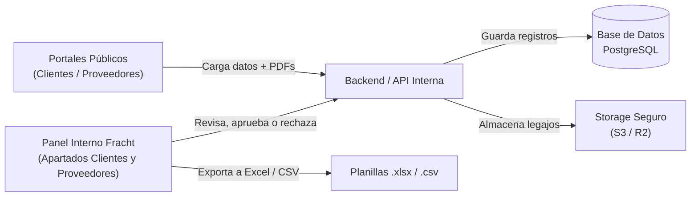

# Guía Técnica y de Negocio: Sistema de Onboarding Digital (Clientes y Proveedores)
> **Documento de soporte para reunión con cliente**  
> **Versión Oficial:** Actualizada al 29 de Octubre de 2026  
> **Objetivo:** Explicar el funcionamiento de la solución, opciones de arquitectura tecnológica, infraestructura recomendada y lineamientos básicos de seguridad.

---

## 1. Resumen Ejecutivo: ¿Qué resuelve este sistema?

El objetivo es **eliminar la carga manual y la dispersión de datos** en el proceso de alta comercial, fiscal y bancaria de nuevos **clientes** y **proveedores**:

- **Antes:** Formularios en Word/PDF por email, documentos adjuntos perdidos en casillas de correo, falta de validación de datos impositivos (CUITs con errores) y demoras operativas entre cobranzas y tesorería.
- **Con esta solución:**
  1. El cliente o proveedor completa un portal web guiado y seguro en pocos minutos.
  2. La empresa recibe el legajo centralizado en un panel de control con **2 apartados independientes** (uno para Clientes y otro para Proveedores).
  3. El equipo correspondiente revisa, valida documentos, aprueba/rechaza con un clic y exporta los datos en Excel para contabilidad/ERP.

---

## 2. Flujo de Funcionamiento (Paso a Paso)

### Paso 1: Portales Web Públicos de Autocarga
- **Portal 1 (Clientes):** Carga de datos comerciales, CUIT con máscara, contacto, condiciones y documentación respaldatoria en PDF.
- **Portal 2 (Proveedores):** Carga de datos comerciales, CUIT con máscara, contacto, condiciones operativas y documentación respaldatoria en PDF.
- **Nota (*):** Ambos formularios corresponden a una estructura base de demostración, sujeta a ajustes según la planilla modelo y requerimientos que provea Fracht Group Argentina.

### Paso 2: Procesamiento y Almacenamiento Seguro
- Se genera un **número de legajo/ticket único** (ejemplo: `CLI-2026-001` o `PRV-2026-001`).
- Los archivos se almacenan en un repositorio de objetos privado (no accesible directamente desde internet).
- Se envía un correo de confirmación de recepción y una alerta al equipo interno de Fracht.

### Paso 3: Panel de Administración Interno (Backoffice Fracht)
- **Apartados Diferenciados:** Navegación centralizada con una vista para **Clientes** y otra para **Proveedores**.
- **Ventajas compartidas en ambos módulos:**
  - Seguimiento de workflow por estados (`Pendiente`, `Aprobado`, `Cargado en ERP`).
  - Visor y descarga de los archivos PDF adjuntos sin forzar descargas en la máquina local.
  - Registro de notas internas o motivos de observación/rechazo.

### Paso 4: Exportación e Integración
- Descarga directa a **Excel (.xlsx)** y **CSV** con los campos formateados para facilitar la importación en su sistema contable/ERP.
- Preparado con endpoints REST limpios para integrarse a futuro si el cliente lo requiere.

---

## 3. Propuesta de Stacks Tecnológicos

Recomendamos **ir a lo seguro y estándar del mercado**: tecnologías con amplísimo soporte, comunidad madura y facilidad para sumar desarrolladores a futuro.

| Componente | Opción A: Simple y Ágil (Recomendada) | Opción B: Todo en Uno (Fullstack) | Opción C: Más Robusta (Corporativa) |
| :--- | :--- | :--- | :--- |
| **Frontend** | **React + Vite** (SPA ligera, veloz, directa) | **Next.js** (React) | **React + Vite** o **Next.js** |
| **Backend** | **Node.js** (Express o Fastify) con TypeScript | **Next.js API Routes / Server Actions** | **NestJS** (Node/TS modular) o **Python (FastAPI)** |
| **Base de Datos** | **PostgreSQL** | **PostgreSQL** | **PostgreSQL** |
| **Cuándo elegirla** | Desarrollo rápido, separación clara entre front y back, costo óptimo. | Máxima velocidad de entrega, un único repositorio de código. | Equipos que exigen arquitectura empresarial estricta por capas. |

> **Nuestra recomendación para iniciar:**  
> **React (Vite) + Node.js (Express/TypeScript) + PostgreSQL.**  
> Es una combinación probada en miles de proyectos, sin sorpresas técnicas, muy estable y con costes operativos mínimos.

---

## 4. Almacenamiento de Archivos (Storage para PDFs)

Dado que los clientes suben estatutos y constancias impositivas (archivos de 1 MB a 15 MB), **no conviene guardarlos dentro del servidor web ni en la base de datos**.

- **Solución Recomendada:** **Object Storage compatible con S3**
  - **Cloudflare R2** o **AWS S3**:
    - Costo prácticamente nulo (menos de USD 1–3 al mes para volúmenes estándar de legajos).
    - Cero mantenimiento de discos físicos.
    - Alta disponibilidad garantizada (99.99%).
  - **Acceso Privado (Presigned URLs):** Los documentos no tienen enlaces públicos. Cuando un operador interno hace clic en *"Ver PDF"*, el sistema genera un link temporal que caduca a los 15 minutos.

---

## 5. Infraestructura, Costos y Hosting

Existen 2 modalidades comerciales para el cliente:

1. **Modalidad Gestionada por Fracht (Autoservicio):**
   - El cliente abona directamente sus servicios cloud:
     - Servidor VPS (Hetzner, DigitalOcean o AWS Lightsail, 2 vCPU / 4 GB RAM): ~$5 a $15 USD/mes.
     - Base de Datos & Almacenamiento Cloud para archivos: ~$5 a $15 USD/mes.
     - Total estimado directo: ~$15 a $30 USD/mes bajo titularidad de Fracht.
2. **Modalidad Llave en Mano R&D SoftAR ($350 USD/mes):**
   - R&D SoftAR absorbe y provee el 100% de la infraestructura (servidor, base de datos, almacenamiento de PDFs, SSL, backups diarios automatizados y soporte continuo), sin gastos sorpresa de nube para Fracht.

---

## 6. Seguridad Básica (Imprescindible y Sin Complejidades Inútiles)

Para dar total tranquilidad a la empresa y a sus clientes sin sobrecargar el proyecto:

1. **Cifrado en Tránsito (HTTPS / TLS):** Todo el tráfico web y la transferencia de datos viajan encriptados de punta a punta.
2. **Protección de Documentos Sensibles:**
   - Bucket de almacenamiento 100% privado (imposible de indexar por Google o acceder sin permisos).
   - Enlaces de descarga temporales con firma criptográfica.
3. **Control de Acceso al Backoffice:**
   - Login seguro con contraseña hasheada (Argon2 / BCrypt) y tokens de sesión JWT.
   - Solo usuarios con rol autorizado pueden ver, aprobar o exportar legajos.
4. **Validación y Filtrado de Cargas:**
   - Verificación estricta de extensiones y validación de tipos MIME (*Magic Bytes* en el servidor) para aceptar exclusivamente PDFs reales.
   - Límite de tamaño por archivo (ej. máx. 10 MB por documento).
5. **Trazabilidad y Auditoría:**
   - Registro automático de fecha, hora e IP de origen al momento del envío del formulario.
   - Bitácora de acciones internas: queda registrado qué usuario administrativo aprobó o rechazó cada solicitud.

---

## 7. Preguntas Frecuentes para la Reunión

**¿Cuánto tiempo toma tenerlo productivo?**  
Al contar ya con el diseño UX/UI validado y la estructura funcional armada en este MVP, la implementación del backend real, base de datos y despliegue toma habitualmente entre **3 y 4 semanas**.

**¿Se puede conectar más adelante a nuestro sistema contable o ERP?**  
Sí. El backend se desarrolla mediante una API REST estándar, lo que permite que a futuro cualquier sistema interno consulte los legajos aprobados de forma automática.

**¿Qué pasa si el cliente deja el formulario a la mitad?**  
Se puede incorporar guardado automático en el navegador (Local Storage) o envío de enlace de recuperación al correo.
